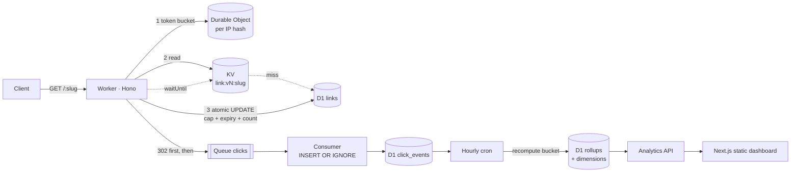

# EdgeLink

> An edge-deployed short-link service with click analytics that stay accurate under abuse,
> bots, and burst traffic.

[](https://github.com/supremeyuma/edgelink/actions/workflows/ci.yml)

**Status:** `v1.0.0` — built and verified locally with Miniflare. The live deploy is deferred
until a Cloudflare account and Workers Paid plan are connected; the exact steps are in
[`docs/deploy.md`](docs/deploy.md). No number in this repo is a deployed measurement.

**Stack:** TypeScript (strict) · Hono · Cloudflare Workers · Wrangler 4 · D1 · KV · Queues ·
Cron Triggers · Durable Objects · Vitest Workers pool · Next.js static dashboard.

## What it does

- Create, update, expire, password-gate, and cap short links behind a bearer-token admin API.
- `GET /:slug` redirects from a versioned KV cache with D1 as the atomic authority for caps.
- Clicks are captured through a queue (`ctx.waitUntil`) and never block the redirect.
- An idempotent consumer dedupes on event UUIDs; hourly cron recomputes rollups from raw events.
- Analytics API and dashboard read **rollups only** — no raw-event scans.
- Per-IP Durable Object token bucket, bot classification, salted IP hashing, static blocklists.

## Architecture



Rules baked in:

- The redirect never awaits analytics. A queue failure is logged, not surfaced.
- The cap/expiry decision is one `UPDATE ... RETURNING`; a stale cache cannot authorize it.
- Cache keys are versioned (`link:v{n}:{slug}`) with a pointer; admin writes bump `version`
  and write through.
- Rollups are recomputed, not blindly incremented; reruns and backfills are idempotent.
- Raw IPs are never stored. `ip_hash = HMAC-SHA256(IP_HASH_SALT, ip)`, salt rotated monthly.

## Measured (local Miniflare, not edge)

| Mode                            | p50    | p95                   | Cache hit rate | Notes                          |
| ------------------------------- | ------ | --------------------- | -------------- | ------------------------------ |
| Cold (300 unique slugs, 20-way) | 429 ms | 475 ms                | 0%             | D1 write queue dominates       |
| Warm probe (100 requests)       | 6.7 ms | 9.9 ms                | 100%           | still pays the atomic D1 write |
| Warm autocannon (8 s, 10 conn)  | 30 ms  | p90 39 ms / p99 50 ms | —              | 315 req/s, 0 errors            |

Method and raw data: [`docs/bench/README.md`](docs/bench/README.md). The cache removes the D1
read, not the counter write. Deployed numbers replace these once an account exists.

## Cost

Queues require **Workers Paid ($5/month)**. At a warm 1M redirects/month the marginal cost is
roughly **$1.50–$3.35**, so a realistic first bill is **$5–$9**. Full assumptions and levers:
[`docs/cost.md`](docs/cost.md).

## Run it locally

Requires Node 22 and pnpm (`packageManager` pins pnpm 12; no corepack needed).

```powershell
pnpm install
Copy-Item .env.example .dev.vars      # or set ADMIN_TOKEN / IP_HASH_SALT yourself
pnpm migrate:local
pnpm dev                              # http://127.0.0.1:8787
```

Create a link:

```powershell
curl.exe -s -X POST http://127.0.0.1:8787/v1/links `
  -H "Authorization: Bearer local-admin-token" `
  -H "Content-Type: application/json" `
  -d '{\"target\":\"https://example.com\",\"slug\":\"demo\"}'
curl.exe -i http://127.0.0.1:8787/demo
```

Dashboard (port 3002):

```powershell
pnpm --filter edgelink-dashboard dev
```

Open <http://localhost:3002>, paste `ADMIN_TOKEN`, create or select a link. The token is kept in
`sessionStorage` only.

Other scripts:

```powershell
pnpm test                 # 54 tests across unit + Workers pool
pnpm run verify           # format, lint, typecheck, OpenAPI, dashboard build, tests, dry-run
pnpm seed                 # three demo links
pnpm backfill 6           # recompute the last 6 completed hours
pnpm bench                # cold/warm benchmark (server must be running)
```

## API

Full spec: [`openapi/openapi.yaml`](openapi/openapi.yaml) · generated types:
`openapi/generated.d.ts` · typed client: [`src/client.ts`](src/client.ts). `pnpm run verify`
fails if the spec or generated types drift.

| Route                                   | Auth   | Purpose                       |
| --------------------------------------- | ------ | ----------------------------- |
| `GET /healthz`                          | —      | liveness                      |
| `GET /readyz`                           | —      | D1 + KV readiness             |
| `GET /robots.txt`                       | —      | disallow crawling             |
| `GET /:slug`                            | —      | 302 / 404 / 401 / 410 / 429   |
| `GET/POST /v1/links`                    | bearer | list / create                 |
| `GET/PATCH/DELETE /v1/links/:slug`      | bearer | detail / update / soft delete |
| `GET /v1/links/:slug/analytics?days=30` | bearer | rollup analytics              |
| `POST /v1/admin/backfill?hours=24`      | bearer | recompute rollup buckets      |

## Design decisions

1. **Versioned KV cache, D1 authority** — the cache saves a lookup, never the atomic cap write.
   [`ADR 001`](docs/adr/001-versioned-kv-cache.md)
2. **Queue + idempotent consumer + recomputed rollups** — analytics cannot slow or break
   redirects, and redelivery cannot inflate counts. [`ADR 002`](docs/adr/002-queue-analytics.md)
3. **Durable Object token bucket** — exact under concurrency; fails open if the DO is down.
   [`ADR 003`](docs/adr/003-rate-limiter-do.md)
4. **Privacy by construction** — salted HMAC of IPs, 30-day raw retention, no raw IP or token in
   logs. [`docs/security.md`](docs/security.md)

## Testing

- Status matrix: 302, 404, 410 (expired/capped/deleted), 401 (admin/password), 400 (target,
  slug, blocklist, patch), 409, 429.
- Cap concurrency: 10 requests against `max_clicks=5` → exactly five 302s and `clicks=5`.
- Cache: warm hit, PATCH visible on the next request, expiry/cap/delete invalidation, negative
  cache cleared on create.
- Analytics: 1,000 events across 3 links, duplicate replay → zero inflation, rollup rerun
  identical, late event corrected, retention boundaries, analytics ignores raw events.
- Abuse: 500-request burst → 429 + `Retry-After`, only allowed requests count, other IP
  unaffected; token bucket refill with a fake clock.
- Privacy: HMAC determinism/salt sensitivity, no raw IP in serialized events, bot/device
  classification, target blocklist.

Failure behaviour is catalogued in [`docs/failure-modes.md`](docs/failure-modes.md); the
engineering narrative is in [`docs/case-study.md`](docs/case-study.md) and
[`docs/interview-notes.md`](docs/interview-notes.md).

## Deploy

Follow [`docs/deploy.md`](docs/deploy.md). Without credentials, the CI deploy workflow is a
no-op and `wrangler deploy --dry-run` remains part of the gate. Do not claim a live URL that
does not exist.

## What's next

- Password entry with a signed short-lived cookie (the API already stores PBKDF2 hashes and
  returns 401).
- Cross-hour unique-visitor sketch instead of summing hourly uniques.
- Cloudflare verified-bot data and native rate-limiting rules.
- Deployed latency/cost numbers and a recorded demo GIF.

## License

MIT
